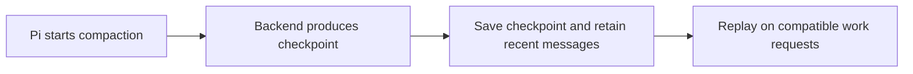

# 🗜️ pi-codex-compact — Use Codex Remote Compaction in Pi

[](https://www.npmjs.com/package/@narumitw/pi-codex-compact) [](https://pi.dev) [](./LICENSE)

Use Responses compaction in Pi to replace older conversation context with an opaque server-generated checkpoint.
The extension replays that checkpoint in later compatible requests. Pi still controls when conversation history is compacted.

## ✨ Features

- Supports built-in Codex, OpenAI, and Azure OpenAI Responses APIs, plus explicitly configured custom APIs.
- Offers Remote Compaction V2, unary `responses/compact`, and experimental streaming Context Management.
- Adapts verified official OpenAI ChatGPT OAuth requests to Context Management before dispatch, including Auto and V2 preferences.
- Handles manual, threshold, and overflow compaction through Pi's normal lifecycle.
- Exposes an optional prepared-checkpoint engine without scheduling speculative work itself.
- Preserves compatible checkpoints across repeated compaction, protocol changes, reloads, resumes, and forks.
- Uses Pi-native fallback before the first checkpoint; afterward, tries checkpoint-aware recovery with lossy native fallback on recovery failure.
- Pauses an operation rejected by OAuth without disabling compatible checkpoint replay.

**Context Management is experimental.** This fork selects it for verified official OpenAI ChatGPT OAuth requests; other authentication routes require explicit selection. It consumes the active route's quota or API usage; support depends on the backend, model, and account.

## 📦 Install

To use this fork, replace the upstream compact entry in Pi's `settings.json` packages array with:

```json
{
  "source": "git:github.com/AHGGG/pi-extensions@main",
  "extensions": ["packages/pi-codex-compact/src/index.ts"],
  "skills": [],
  "prompts": [],
  "themes": []
}
```

Restart Pi after resolving the Git package. This filter loads only the compaction extension. Remove `npm:@narumitw/pi-codex-compact` from the same installation scope to avoid loading two copies. The upstream npm package does not contain this fork's OAuth routing, 15-minute timeout, changes.

The upstream npm package is available separately:

```bash
pi install npm:@narumitw/pi-codex-compact
```

Try the upstream published package without installing:

```bash
pi -e npm:@narumitw/pi-codex-compact
```

Try a local checkout from the repository root:

```bash
npm --workspace @narumitw/pi-codex-compact run build
pi -e ./packages/pi-codex-compact
```

The package declares `dist/index.ts`, so build a local checkout before loading its package directory.
Loading it enables automatic Responses compaction routing with the defaults below.
Do not load a global npm installation and the local workspace at the same time.

Pi extensions run with your user permissions. Review third-party extension source before installing it.

## 🚀 Quick start

1. Sign in through Pi's built-in OpenAI, OpenAI Codex, or Azure OpenAI provider.
2. Select a model using `openai-codex-responses`, `openai-responses`, or `azure-openai-responses`.
3. Work normally. Pi's automatic compaction and built-in `/compact` remain available.

After successful remote compaction, compatible requests replay the checkpoint automatically.
Signing in does not guarantee compaction permission; see [ChatGPT OAuth rejection](#chatgpt-oauth-rejection) if the backend refuses the operation.

## 💬 Commands

Run `/codex-compact` without arguments to inspect the effective route, change settings, or select **Compact now** in TUI mode.
Closing the menu with Escape or Ctrl+C does not compact the session; settings changes already saved remain applied.
The no-argument command reports the manual settings path in RPC and is rejected in print and JSON modes.
Arguments are rejected. The former `/codex-compact resume` migration route has been removed; this engine does not own scheduling controls.
Pi's built-in `/compact` uses the same compaction routing.

## ⚙️ Settings

Use `/codex-compact` → **Settings**, or edit the global JSON file at `<getAgentDir()>/pi-codex-compact.json` (normally `~/.pi/agent/pi-codex-compact.json`).
There are no project or extension-specific environment-variable overrides. Missing fields use defaults.

For example, select Remote V2 explicitly on a compatible backend:

```json
{
  "protocol": "remote-v2"
}
```

With `auto`, verified official OpenAI ChatGPT OAuth uses Context Management; API-key OpenAI and Azure use unary `responses/compact`, and legacy Codex uses Remote V2. The OAuth adaptation also applies to explicit V2 and Compact preferences. Remote V2 is unsupported on the current official `openai` ChatGPT OAuth subscription-sharing route: its `compaction_trigger` input is rejected. This is not a universal restriction on V2, API-key routes, or the separate Codex backend. Other APIs remain Pi-native unless explicitly configured. The menu reports the last resolved protocol after a compaction attempt without refreshing OAuth merely to display it.

Preparation scheduling is not part of this engine. Compatible consumers can use the [versioned prepared-compaction interface](./docs/prepared-compaction-protocol.md).

Prepared work assumes one ChatGPT login for its lifetime. For verified official ChatGPT OAuth, token refresh alone does not invalidate preparation; model, route, provider, headers, environment, and other authentication metadata still must match. API keys and custom routes retain exact credential checks. Pi does not expose a stable login identity here, so a real account switch that changes only the token cannot be distinguished from refresh: cancel prepared work and restart the session before switching accounts. No credentials are changed or stored in checkpoints.

Menu changes apply immediately. Manual file edits take effect on `/reload` or the next session start. Invalid settings files remain unchanged and make the menu read-only until repaired and reloaded.

See the [settings reference](./docs/settings.md) for all fields, defaults, accepted values, custom API configuration, and save/reload behavior. This extension does not read `~/.codex/config.toml`.

## ✅ Requirements and compatibility

You need compatible Pi peer APIs, working provider credentials, and a backend that supports both the selected compaction protocol and opaque checkpoint replay.
The model must use a built-in Responses API or a custom API explicitly mapped through `apiProfiles`.
The provider adapter must honor Pi's public `onPayload` and injected `fetch` options; Context Management and summary recovery also need ordered `onProviderStreamEvent` callbacks.

| Model API | `auto` route | Other selectable route |
| --- | --- | --- |
| `openai-codex-responses` | Responses Remote V2 | Responses Compact API, experimental Context Management |
| `openai-responses` | Context Management for verified official ChatGPT OAuth; Responses Compact API otherwise | API-key routes honor the selected protocol; verified ChatGPT OAuth always uses Context Management |
| `azure-openai-responses` | Responses Compact API | Responses Remote V2, experimental Context Management |

For a custom API, map its exact non-built-in label to `"codex-responses-v1"` in `apiProfiles`. This profile uses Remote V2 in `auto` mode and requires Codex-compatible request fields and replay; it declares compatibility rather than probing the backend. With unary compaction selected, it retains Codex-supported tools and reasoning.
Built-in adapter tests cover request plumbing, not backend support or hosted entitlement. A custom provider or proxy remains responsible for its routing, authentication, and payload transforms. See the [implementation reference](./docs/implementation.md#protocol-and-replay) for the protocol contract.

Within the same provider, checkpoints can replay across models when their Responses API label and compatibility profile match. Custom checkpoints also require the matching `apiProfiles` entry.
Changing providers transfers the checkpoint through its issuing provider as a plaintext summary when summary recovery is enabled. The selected provider never receives the issuer's encrypted checkpoint. This transfer can consume quota and lose detail; missing issuer access or a failed transfer stops the request and preserves history.
The extension does not make capability probes or automatically retry a failed billable request through another protocol.

### Prepared-compaction interface

The engine exposes a documented, versioned [prepared-compaction protocol](./docs/prepared-compaction-protocol.md) over Pi's public event bus. Any compatible consumer can prepare a checkpoint and request safe application without private imports or package identity checks. No consumer is required for ordinary compaction, and this engine alone performs no speculative requests.

### Experimental Context Management

For a backend supporting [server-side compaction](https://developers.openai.com/api/docs/guides/compaction), select **Context Management (experimental)** in `/codex-compact` → **Settings** → **Protocol**, or save this setting and reload Pi:

```json
{
  "protocol": "context-management"
}
```

This route was verified with Pi's **OpenAI → Sign in with ChatGPT**, `gpt-5.5`, and streaming `api.openai.com/v1/responses`: a checkpoint recovered an assistant-only synthetic fact without the original plaintext. This does not establish support for other accounts, models, Azure, Codex, or proxies.

By default, compaction makes a separate inference request that asks for a concise work handoff, not a fixed `OK` reply. **Append maintenance message** can omit that user message, and **Maintenance message** can edit it or restore the built-in text. Both settings affect Context Management only; the server compaction field, 1,024-token threshold, tools-disabled policy, and strict completion validation stay unchanged. The separate fallback recovery summary prompt is unaffected. Disabling or customizing the message is experimental and is not a proven fix for long-running EOF failures. Tools are disabled only for that maintenance request. Safe generated output is saved with the checkpoint, not displayed as new assistant work. Missing or unsafe output follows the fallback/recovery policy; very short history may not meet the server's 1,024-token threshold. Both maintenance and recovery can consume quota.

After successful automatic compaction during a user run, work continues without another user message. Existing Pi retries and queued work are reused; otherwise, the extension can start one extra work request per user run, even if that request compacts again. Normal tools remain available, so the extra request can consume quota and execute actions. It asks the model not to repeat completed work, but cannot guarantee model compliance or task completion.

Continuation follows the successful checkpoint protocol, so it also applies when an Auto or V2 preference resolves to Context Management. Manual compaction, native fallback, plaintext recovery, checkpoints produced by other protocols, and restored checkpoints do not start this extra request. Failure, cancellation, terminal errors, session changes, or incompatible model/settings suppress pending continuation. Other extensions using Pi's continuation API can override it.

For other authentication routes, select `auto` or another protocol to stop new Context Management attempts while leaving the extension enabled for replay. Verified official ChatGPT OAuth still resolves to Context Management for every preference. Existing checkpoints are not rewritten and can contain older maintenance instructions or `OK` output. Older package versions do not understand Context Management checkpoints; retain a supporting version for these sessions.

Compatible replay reasserts provider-native `additional_tools` declarations after the opaque checkpoint without changing schemas; later tool changes retain their original ordering. This starts a new request prefix on first replay after upgrading, then remains stable across ordinary turns. Existing compatible checkpoints need no migration. Top-level declarations and Pi active-tool controls are unchanged. Deterministic tests verify request layout; hosted tool availability after this repair still requires validation.

### ChatGPT OAuth rejection

Before dispatch, this fork matches Pi's fresh public provider-auth result (`source: "OAuth"`) to the actual resolved request credential. The adaptation requires provider `openai`, API `openai-responses`, and the official `https://api.openai.com/v1` base URL (an optional trailing slash is accepted). Proxy base URLs and `Authorization` or `cf-aig-authorization` overrides are excluded. Missing provenance does not establish OAuth: the configured route is retained. Token contents and credential files are not inspected, and credentials or saved preferences are not rewritten.

Pi's **OpenAI → Sign in with ChatGPT** route at `api.openai.com` is distinct from the legacy **OpenAI Codex** route at `chatgpt.com/backend-api/codex`. Permission on one does not establish permission on the other. General compaction API documentation also does not establish OAuth permission.

A backend can reject an operation with:

```text
code=hardened_oauth_rule_missing
type=rejected_by_hardened_oauth_boundary
message=This ChatPass credential is not authorized for the requested operation.
```

The extension reports the rejection and pauses that operation for the session route. Without a checkpoint, it falls back to Pi-native compaction; with one, it uses [checkpoint recovery](#checkpoint-recovery). The OAuth adaptation happens before the first dispatch; a failed request is not retried with different credentials, providers, or protocols. The menu's selected or resolved route is not an entitlement check.

Changing the protocol or backend can permit a new attempt; switching back to the rejected route remains paused. `/reload` or a new session clears the pause. Re-login or upgrading Pi is not a guaranteed remedy. See OpenAI's [inference](https://developers.openai.com/siwc/token-sharing-open-source/models-and-inference) and [errors and recovery](https://developers.openai.com/siwc/token-sharing-open-source/errors-and-recovery) guidance, plus the [route-pause details](./docs/implementation.md#oauth-rejection-state).

**Turning Remote compaction off also disables opaque checkpoint replay.** Do this only for sessions that do not need an existing checkpoint. Otherwise, leave the extension enabled and use recovery; disabling it exposes only the fallback marker and recent messages.

### Checkpoint recovery

Pi's native summary generator cannot read encrypted checkpoint history. Direct native fallback after a checkpoint can therefore lose older context.

If a speculative preparation fails, the next actual compaction first makes **one fresh invisible checkpoint attempt** with current credentials and its own timeout. Configured bounded provider retries still apply. Only if this foreground attempt also fails does recovery below begin. A cancelled automatic-application claim starts no new inference, and OAuth-rejected routes remain paused.

After remote failure with a checkpoint, **Checkpoint recovery → Summarize** (the default) makes a normal inference request through the same compatible provider/model and Pi-managed credentials. It replays the checkpoint, disables tools, and replaces it with a bounded plaintext summary while retaining the recent tail and file metadata. This consumes quota and is lossy; successful validation cannot prove that every fact was preserved. Ordinary work requests do not receive recovery instructions.

If the recovery request fails, times out, or returns invalid or oversized output, **Summarize falls back to Pi-native compaction**. Native compaction can summarize only the fallback marker and visible history; **older context stored only in the opaque checkpoint may be lost**. With `notifyOnFallback` enabled, the extension warns before handing control back to Pi. Recovery and native summarization can each consume quota; native failure follows Pi's normal failure handling.

**Checkpoint recovery → Cancel** avoids the recovery request and native fallback and preserves history. Invalid or incompatible checkpoints, unverifiable projection, or a changed recovery backend still cancel. Cancellation, session changes, shutdown, model selection, and completed tree navigation stop owned compaction work rather than triggering fallback. Neither recovery mode changes fallback before the first checkpoint. A context-limit turn can remain blocked until compaction succeeds.

If checkpoint projection cannot be verified, another recovery attempt cannot repair it. Keep a backup, use `/tree` to branch before the opaque checkpoint, decline optional branch summarization, and compact the saved transcript on that branch. For nested checkpoints, branch before the earliest required one or restore the original transcript from backup. The abandoned branch is unchanged; missing opaque-only history cannot be decoded locally.

Keep the extension enabled while the active session needs its checkpoint; recovery does not override `enabled: false`. Hosted checkpoint-to-text recovery remains unverified. Adapter tests establish safe request/publication behavior, not hosted recall.

## 🧭 How it works

Pi chooses when to compact and which recent messages to keep. The extension requests a checkpoint for older context, saves it in the session, and replays it alongside the retained messages on compatible requests. An optional companion may supply a previously prepared checkpoint through the [versioned engine protocol](./docs/prepared-compaction-protocol.md).



If a request fails, the extension uses native fallback before the first checkpoint or checkpoint-aware recovery afterward, with lossy native fallback if the recovery request fails. See the [implementation reference](./docs/implementation.md) for protocol fields, checkpoint validation, continuation, and legacy format handling.

## 🔒 Security and privacy

Remote compaction sends conversation context and the system prompt to the configured Responses backend. Remote V2 and Context Management also send active tool schemas; Codex-profile unary requests retain provider-supported tools.
New checkpoints use format v4, including the snapshot cutoff for prepared checkpoints; v1–v3 checkpoints remain readable. Keep a v4-capable extension installed when resuming these sessions, because older versions cannot replay the new format.

The session stores the provider ID, encrypted checkpoint, and bounded retained user items or Context Management output. It does not store credentials or authorization/request headers in checkpoint details.

| Boundary | Limit |
| --- | ---: |
| Observed SSE stream or unary JSON response | 8 MiB |
| Serialized checkpoint or retained output item | 2 MiB |
| Persisted replacement history | 8 MiB |
| Retained user text or Context Management output suffix | 64K approximate tokens by default; configurable from 8K to 128K |
| Settings file | 64 KiB |
| Transport retries | At most 2 |
| Request timeout | At most 30 minutes; default 5 minutes |

An individually oversized media item is dropped. The oldest fitting retained text item may be partially truncated to preserve newer context.
Context Management does not retain the original plaintext alongside its checkpoint and fails rather than truncating oversized post-checkpoint output. Hard byte ceilings are not configurable.

### Compaction diagnostics

Every dispatched compaction operation emits one bounded safe diagnostic summary in UI modes, on success or failure; failure-triggered checkpoint recovery emits a separate summary. Stale or user-cancelled operations do not notify a replaced session. These summaries are independent of the fallback-warning toggle. It reports the operation phase and elapsed seconds, HTTP attempt count, last-attempt status/time to headers, content-type category, observed body bytes/chunks and idle time, and provider-observed terminal event counts. No prompts, credentials, URLs, response IDs, arbitrary headers, provider event content, or checkpoint contents are added to these metrics.

`terminal(c/d/i/f/e)` counts observed `response.completed`, `response.done`, `response.incomplete`, `response.failed`, and `error` events. `abort(d/c/p)` reports whether the extension deadline, caller signal, or provider-supplied fetch signal was observed aborted; overlapping flags are possible and do not identify a root cause. The caller signal can represent a prepared deadline or route cancellation, not just user cancellation. `body=eof` means the observed byte stream ended, not that a valid checkpoint completed; `pipe-error` can also mean downstream cancellation. `open` at the failure snapshot does not prove the socket is still open: asynchronous pipe teardown may not yet have settled. Counts describe the existing bounded stream observer, not network packets, and provider hooks may omit events rejected internally by the SDK. Per-attempt counters reset on retry; elapsed time and the attempt count cover the operation. A `-` means no observation was available.

Prepared failure handles carry a shorter summary (`t` elapsed seconds, `n` attempts, `http` status, `term` and `abort` use the same order) so diagnostics survive bounded caller displays. The detailed stream milestones are available for Context Management and recovery; other protocols report the observations their provider exposes (unary Compact has no streamed output items). `kind=recovery` means ordinary summary inference, with `resolved` describing the originating compaction route, not a second server compaction. `milestones-ms(firstByte/firstEvent/firstCompaction/terminal/lastByte)` records offsets from the final HTTP attempt's dispatch. `items(compaction/reasoning/message/other)` counts only observed `response.output_item.done` categories, not terminal-array items. Stage milliseconds report binding (including auth), auth wait, context preparation, and collector validation; these overlap and must not be summed. The operation line separately reports total time (including recovery when used) and checkpoint replacement validation. `ready` means returned to Pi for application, and `prepared` means prepared for a caller; neither claims the checkpoint has been persisted. Consumer-owned adoption, Pi-native fallback, and separate cross-provider transfer timings are outside these summaries. Prompt text, including custom maintenance instructions, is never included in these summaries. Per-attempt fields describe the last attempt, not a full retry history.

Diagnostics do not change retry, timeout, cancellation, checkpoint validation, or recovery policy and cannot determine why a remote request stalled by themselves.

## 🚧 Limitations

- Backend compaction contracts and OAuth restrictions can change independently; keep backups of important sessions.
- Older history requires this extension, a matching API/profile/model, and a backend that accepts the checkpoint. Removing the extension exposes only the fallback marker and recent messages.
- The package does not reproduce Codex core's context-window lineage, previous-model fallback, exact pre-turn ordering, or exact mid-turn model-session ownership.
- Pi's public tool metadata omits `constrainedSampling`; Remote V2 preserves active tool order, names, descriptions, and schemas but cannot reproduce that optional field.
- Successful recovery replaces active opaque history with a lossy summary; native fallback after recovery failure cannot read opaque-only history. Raw session entries remain available, but rolling back the extension does not restore the active context. Use `/tree` before the required checkpoint or restore a transcript backup.
- Settings saves are ordered within one Pi process, not locked across processes; a detected concurrent edit is rejected.

## 📊 Benchmark

The repository benchmark compares full context, Pi-native summaries, and Remote V2 using seeded histories. Its v3 protocol uses repeated artifacts, isolated probes, paired seed statistics, and committed manifests. It does not treat equal nominal token settings as equal information capacity or claim that exploratory evidence is held out.

Preview the exploratory diagnostic without a provider request:

```bash
npm run benchmark:codex-compact
```

Live runs require `--live`, cost/privacy review, OpenAI Codex OAuth, and Remote V2 entitlement. See the [benchmark guide](https://github.com/narumiruna/pi-extensions/tree/main/packages/pi-codex-compact/benchmark) for methodology, archived v2/v3 evidence, and consumed seeds that cannot be reused for confirmation.

## 🧪 Development

From the repository root:

```bash
npm --workspace @narumitw/pi-codex-compact run check
npm test
npm run package:pack -- codex-compact
```

See the bundled [implementation reference](./docs/implementation.md) and repository [Codex mechanism notes](https://github.com/narumiruna/pi-extensions/blob/main/docs/implementation-notes/codex-compaction-mechanism.md).

## 🗂️ Package layout

```text
packages/pi-codex-compact/
├── src/                       # Implementation; index.ts is the thin source entrypoint
├── dist/                      # Generated Jiti runtime, built from src/index.ts
├── docs/                      # Published settings and implementation references
├── scripts/build-runtime.mjs  # Runtime builder
├── benchmark/                 # Repository-only benchmark and methodology
└── test/                      # Behavior and lifecycle coverage
```

The generated runtime does not import back into `src`.

## 🔎 Keywords

Pi extension, OpenAI Codex, ChatGPT OAuth, Azure OpenAI, Responses API, remote compaction, context management, opaque checkpoint.

## 📄 License

[MIT](LICENSE)

## Optional session scratchpad

Enable **Scratchpad** in `/codex-compact` → Settings, or use `/scratchpad on`.
`/scratchpad off` disables the tool without deleting notes; `/scratchpad` and
`/scratchpad toggle` toggle it, and `/scratchpad status` reports the setting.
Use `/scratchpad show` in TUI mode to view this session’s full notes, IDs, and
timestamps in a read-only scrollable screen, even while the tool is Off.
This is one saved `scratchpadEnabled` preference (default `false`), shared by the
menu and command and retained across sessions. Pi's explicit tool selection or
exclusions still apply. It works independently of the remote-compaction toggle.

The agent gets one `scratchpad` tool for session-specific items with stable IDs,
text, and UTC creation/update timestamps. It supports reads and atomic add,
update, and delete batches. Notes live under Pi's configured agent directory at
`scratchpads/<session-id>.json`. Resume reuses that file; new/forked sessions get
separate empty notes. `/tree` does **not** rewind notes.

When both **Scratchpad** and **Append maintenance message** are On, Context
Management compaction captures the current complete notes (up to 16 KiB of
serialized JSON) and places them before the maintenance instruction. Your custom
instruction is preserved, followed by guidance to avoid repeating unchanged saved
details while retaining missing facts, corrections, constraints, and the next action.
Empty notes add nothing. Unreadable or oversized notes are omitted without truncation,
with a warning when fallback notifications are enabled; normal maintenance continues.

There is no extra summarizer, post-compaction note injection, or dependency on the
background-compaction extension. The agent reads live notes when needed. A background
request uses its captured notes; later edits do not restart it or get overwritten.
Toggling scratchpad changes compaction identity and can invalidate prepared work.
Other compaction protocols and recovery-summary prompts are unchanged. This guides
the readable handoff, not the server-controlled opaque checkpoint's exact contents.

See [Scratchpad tool contract](docs/scratchpad.md) for operations, limits, direct
editing, and errors.
